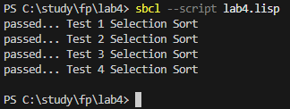
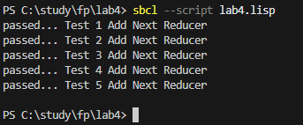

<p align=center><b>МОНУ НТУУ КПІ ім. Ігоря Сікорського ФПСПМ СПіСКС</b></p>
<p align=center><b>Звіт з лабораторної роботи 4</b><br/>
"Функції вищого порядку та замикання"<br/>
дисципліни "Вступ до функціонального програмування"</p>
 
<p align=right><b>Студент</b>: Ткаченко Володимир КВ-33</p>
<p align=right><b>Рік</b>: 2026</p>

## Загальне завдання
Завдання складається з двох частин:
1. Переписати функціональну реалізацію алгоритму сортування з лабораторної
роботи 3 з такими змінами:
використати функції вищого порядку для роботи з послідовностями (де/якщо
це доречно, в разі, якщо функції вищого порядку не були використані при
реалізації л.р. №3);
додати до інтерфейсу функції (та використання в реалізації) два ключових
параметра: key та test , що працюють аналогічно до того, як працюють
параметри з такими назвами в функціях, що працюють з послідовностями (р.
12). При цьому key має виконатись мінімальну кількість разів.
2. Реалізувати функцію, що створює замикання, яке працює згідно із завданням за
варіантом. Використання псевдофункцій не забороняється, але, за
можливості, має бути зменшене до необхідного мінімуму.
## Варіант першої частини 16 (1)
Алгоритм сортування вибором за незменшенням.
## Лістинг реалізації першої частини
``` lisp
(defun selection-sort (lst &key (key nil) (test #'<))
    (cond
        ((null lst) nil)
        ((= (length lst) 1) lst)
        (t
            (let ((arr (copy-list lst)) (lst-length (length lst)) (current (first lst)) (min (first lst)) (actual-key (if key key #'identity))) 
                (dotimes (i (- lst-length 1))
                    (setq current (nth i arr))
                    (setq min (reduce (lambda (a b) (if (funcall test (funcall actual-key a) (funcall actual-key b)) a b)) (nthcdr i arr)))
                    (if (not (equal current min))
                        (setq arr (append (subseq arr 0 i) (cons min (remove min (nthcdr i arr) :count 1))))))
                arr))))
```
## Тестові набори та утиліти першої частини
``` lisp
(defun check-my-function (name func input expected )
(format t "~:[FAILED~;passed~]... ~a~%"
(equal (funcall func input) expected) name))

(defun run-tests-selection-sort()
    (check-my-function "Test 1 Selection Sort" #'selection-sort nil nil)
    (check-my-function "Test 2 Selection Sort" #'selection-sort '(1) '(1))
    (check-my-function "Test 3 Selection Sort" #'selection-sort '(3 2 5 5 1 1) '(1 1 2 3 5 5))
    (check-my-function "Test 4 Selection Sort" #'selection-sort '(6 6 6 6 6) '(6 6 6 6 6))
    (format t "~%")
)
``` 
## Тестування першої частини
<p align=left>

</p>

## Варіант другої частини 16 (4)
Написати функцію `add-next-reducer`, яка має один ключовий параметр — функцію
`transform`. `add-next-reducer` має повернути функцію, яка при застосуванні в якості
першого аргументу `reduce` робить наступне: кожен елемент списку-аргументу `reduce`
перетворюється на точкову пару, де в комірці CAR знаходиться значення поточного
елемента, а в комірці CDR знаходиться значення наступного елемента списку (тобто
того, що знаходиться "справа"). Якщо функція `transform` передана, тоді значення
поточного і наступного елементів, що потраплять у результат, мають бути змінені згідно
`transform` . Обмеження, які накладаються на використання функції-результату `addnext-reducer` при передачі у reduce визначаються розробником (тобто, наприклад,
необхідно чітко визначити, якими мають бути значення ключових параметрів функції
`reduce` `from-end` та `initial-value` ). transform має виконатись мінімальну кількість
разів.

## Лістинг реалізації другої частини
``` lisp
(defun add-next-reducer (&key (transform nil))
  (lambda (current-item accumulator)
    (let ((transformed-item (if transform 
                                (funcall transform current-item) 
                                current-item)))
      (if (null accumulator)
          (list (cons transformed-item nil))
          (cons (cons transformed-item (caar accumulator)) 
                accumulator)))))
```
## Тестові набори та утиліти другої частини
``` lisp
(defun check-my-function (name func input expected )
(format t "~:[FAILED~;passed~]... ~a~%"
(equal (funcall func input) expected) name))

(defun run-tests-add-next-reducer()
    (check-my-function "Test 1 Add Next Reducer" (lambda (lst) (reduce (add-next-reducer) lst :from-end t :initial-value nil)) '(1 2 3 4) '((1 . 2) (2 . 3) (3 . 4) (4 . NIL)) )
    (check-my-function "Test 2 Add Next Reducer" (lambda (lst) (reduce (add-next-reducer) lst :from-end t :initial-value nil)) nil nil )
    (check-my-function "Test 3 Add Next Reducer" (lambda (lst) (reduce (add-next-reducer) lst :from-end t :initial-value nil)) '(1) '((1 . NIL)) )
    (check-my-function "Test 4 Add Next Reducer" (lambda (lst) (reduce (add-next-reducer) lst :from-end t :initial-value nil)) '(1 (2 . 2) 3 4 5) '((1 . (2 . 2)) ((2 . 2) . 3) (3 . 4) (4 . 5) (5 . NIL)))
    (check-my-function "Test 5 Add Next Reducer" (lambda (lst) (reduce (add-next-reducer :transform #'1+) lst :from-end t :initial-value nil)) '(1 2 3 4) '((2 . 3) (3 . 4) (4 . 5) (5 . NIL)) )
    (format t "~%")
)
``` 
## Тестування другої частини
<p align=left>

</p>
