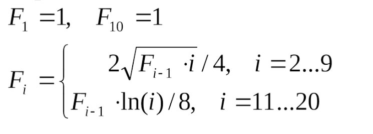
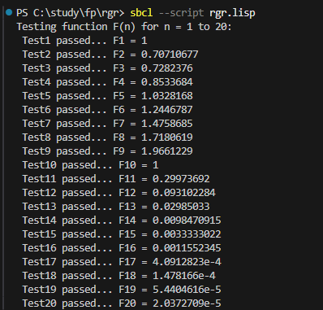
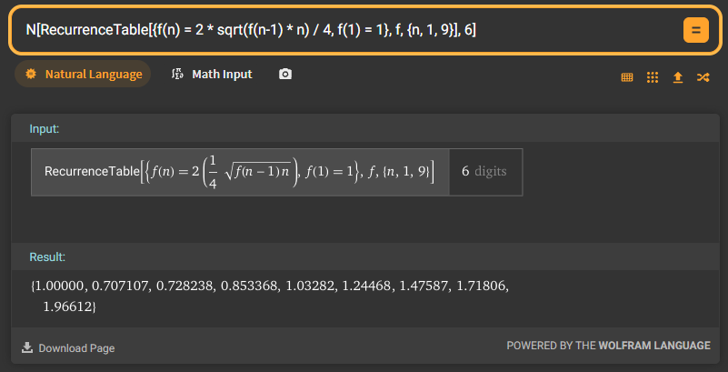
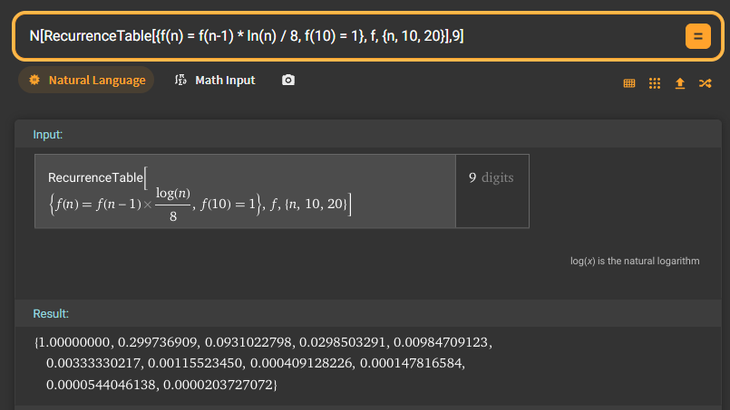

<p align=center><b>МОНУ НТУУ КПІ ім. Ігоря Сікорського ФПСПМ СПіСКС</b></p>
<p align=center><b>Звіт з розрахунково-графічної роботи</b><br/>
дисципліни "Вступ до функціонального програмування"</p>
 
<p align=right><b>Студент</b>: Ткаченко Володимир КВ-33</p>
<p align=right><b>Рік</b>: 2026</p>

## Загальне завдання
1. Реалізувати програму для обчислення функції згідно варіанту мовою Common Lisp.
2. Виконати тестування реалізованої програми.
3. Порівняти результати роботи програми мовою Common Lisp с розрахунками іншими засобами.

## Завдання за варіантом 16
<p align=left>

</p>

## Лістинг розробеної програми
``` lisp
(defun func (i)
    (cond
        ((= i 1) i)
        ((and (> i 1)(< i 10)) 
            (/ (* 2 (sqrt (* (func (- i 1)) i))) 4))
        ((= i 10) 1)
        ((and (> i 10) (< i 21)) 
            (/ (* (func (- i 1)) (log i)) 8))
        (t "Wrong input value")))
```
## Тестові набори та утиліти
``` lisp
(defun test-func (test-info)
    (format t "Testing function F(n) for n = 1 to 20:~%")
    (let ((result-list '(1.000000 0.7071068 0.7282377 0.8533684 1.032817 1.244679 1.475868 1.718062 1.966123
                         1.00000000 0.299736909 0.0931022798 0.0298503291 0.00984709123 0.00333330217 0.00115523450 0.000409128226 0.000147816584 0.0000544046138 0.0000203727072)))
    (loop for i from 1 to 20 do
    (let ((result (func i)))
        (format t " Test~a ~:[FAILED~;passed~]..." i (if (< i 10) (< (abs (- result (nth (- i 1) result-list))) 1e-6) (< (abs (- result (nth (- i 1) result-list))) 1e-8)))
        (if test-info (format t " F~a = ~a~%" i result) (format t "~%"))))))
``` 
## Результати тестування
<p align=left>

</p>

## Порівняння результатів розробленої програми з результатами калькулятора
Як онлайн-калькулятор використано Wolfram Alpha. Щоб результати можна було порівняти коректно, незалежно від нюансів роботи з числами з плаваючою комою та накопичення машинної похибки, введемо допустиму похибку і будемо обчислювати з точністю до 6 знаків для першої функції та 8 знаків для другої.

Рівняння для першої частини (i = 2...9) буде задаватись: `N[RecurrenceTable[{f(n) = 2*sqrt(f(n-1) * n) / 4, f(1) = 1}, f, {n, 1, 9}], 7]`
<p align=left>

</p>

Рівняння для другої частини (i = 10...20) буде задаватись: `N[RecurrenceTable[{f(n) = f(n-1) * ln(n) / 8, f(10) = 1}, f, {n, 10, 20}],9]`
<p align=left>

</p>


### Порівняльна таблиця отриманих значень
| $i$ | Результат Common Lisp (без округлення) | Результат Wolfram Alpha (округлений) |
| :---: | :--- | :--- |
| **1** | 1 | 1.000000 |
| **2** | 0.70710677 | 0.7071068 |
| **3** | 0.7282376 | 0.7282377 |
| **4** | 0.8533684 | 0.8533684 |
| **5** | 1.0328168 | 1.032817 |
| **6** | 1.2446787 | 1.244679 |
| **7** | 1.4758685 | 1.475868 |
| **8** | 1.7180619 | 1.718062 |
| **9** | 1.9661229 | 1.966123 |
| **10** | 1 | 1.00000000 |
| **11** | 0.29973692 | 0.299736909 |
| **12** | 0.093102284 | 0.0931022798 |
| **13** | 0.02985033 | 0.0298503291 |
| **14** | 0.0098470915 | 0.00984709123 |
| **15** | 0.0033333022 | 0.00333330217 |
| **16** | 0.0011552345 | 0.00115523450 |
| **17** | 4.0912823e-4 | 0.000409128226 |
| **18** | 1.478166e-4 | 0.000147816584 |
| **19** | 5.4404616e-5 | 0.0000544046138 |
| **20** | 2.0372709e-5 | 0.0000203727072 |
